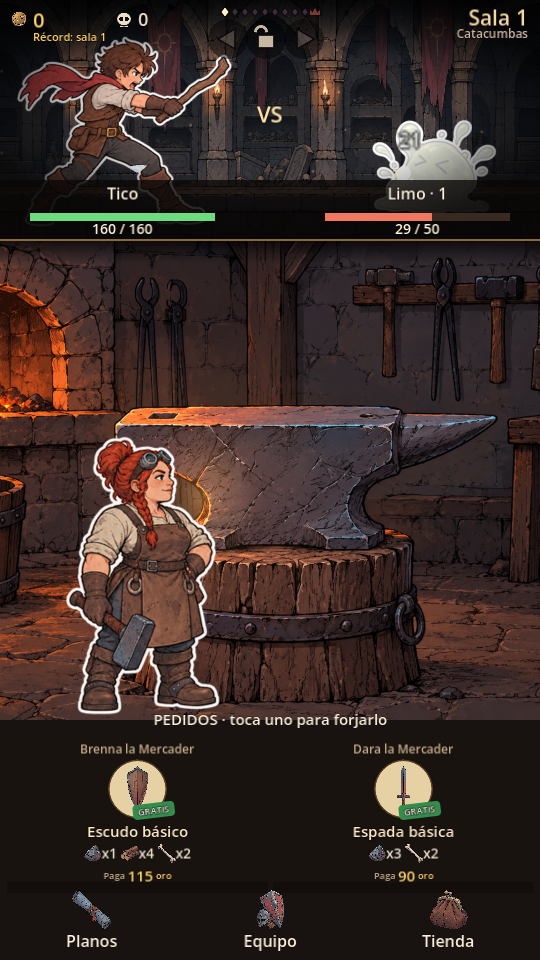
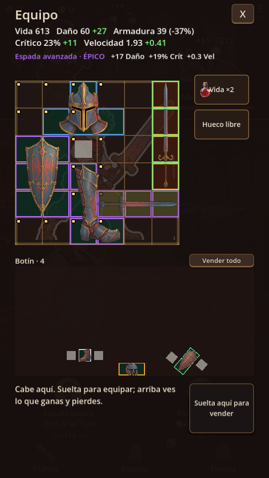

# Ajustes visuales y de interacción — 2 de octubre de 2026

Aplicados los doce cambios definidos. El gesto de giro en móvil sigue pendiente de decisión.

| Petición | Resultado |
| --- | --- |
| Tico más grande | Altura visible de 86,4 unidades sobre una mazmorra de 96: 90 %. El tamaño se calcula sobre la silueta, sin contar el margen transparente. |
| Combate VS | Combatientes y cámara en posiciones fijas. Se alternan las poses sticker de reposo, ataque, daño y derrota. El avance de salas mantiene sus reglas. |
| Herrera protagonista | Brasa ocupa aproximadamente el 55–60 % de la altura visible del taller. Es una proporción inicial ajustable. En horno sigue presente; otras estaciones ocupan el primer plano. |
| Botones ligeros | Navegación horizontal, iconos centrados y fondos discretos. |
| Tienda compacta | Materiales en dos columnas con icono, existencias, cantidad de compra y precio. Tipografía sencilla y menos contenedores. |
| Quitar mochila | Solo equipo y botín físico en la interfaz. Las piezas antiguas pasan al botín al cargar, abrir equipo o guardar. |
| Controles | Principal selecciona y arrastra; secundario gira, también durante el arrastre. Se mantienen R y rueda como accesos adicionales. |
| Giro móvil | Pendiente. No se ha activado el gesto con segundo dedo. |
| Legibilidad | Fuente sencilla, mayor tamaño y contraste para ingredientes, estadísticas, tienda y minijuegos. |
| Colocación | Indicadores verdes para huecos libres y dorados para intercambios. Destino rojo y motivo textual cuando la pieza sale de la rejilla o solapa varias piezas. |
| Comparar equipo | Antes de soltar se muestran las diferencias de atributos, incluidos los efectos de auras, calidad y rango. |
| Forja integrada | Fondo ilustrado del taller durante el minijuego, con estaciones en primer plano. |
| Combate claro | Nombres y vidas en una franja propia; avisos de jefe y muerte ocultan VS y posponen otros avisos. La derrota explica la sala de reaparición y que conservas equipo y botín. |

## Conservación de partidas

La mochila queda retirada como destino. Se conserva la lectura del formato antiguo para trasladar sus piezas al botín sin duplicarlas. La migración mantiene identidad, rotación, calidad y demás datos serializados; no cambia el equipo puesto ni los materiales. Las capturas usan `--art-preview`, que no carga ni guarda la partida personal. Las pruebas de persistencia usan ranuras independientes dentro de `logs/test-saves`.

## Verificación

- Inventario: 524 comprobaciones, 0 fallos.
- Botín físico: 309 comprobaciones, 0 fallos.
- Combate y presentación: 161 comprobaciones, 0 fallos.
- Migración y nuevos controles: 13 comprobaciones, 0 fallos.
- Total: **1.007 comprobaciones, 0 fallos**.
- Revisión visual de principal, equipo, comparación, rechazo, tienda, muerte, jefe y los cuatro minijuegos. Sin errores de análisis de scripts en las capturas revisadas.

## Capturas

Vista principal:

Comparación antes de equipar:

Otros ejemplos: [posición rechazada](ux-reject.png), [tienda](ux-shop.png), [derrota](ux-death.png), [jefe](ux-boss.png), [horno](ux-forge.png), [martillo](ux-hammer.png), [costura](ux-sew.png) y [temple](ux-quench.png).

El inventario completo del arte generado está en [el resumen de producción](resumen-produccion-2026-10-02.md).
