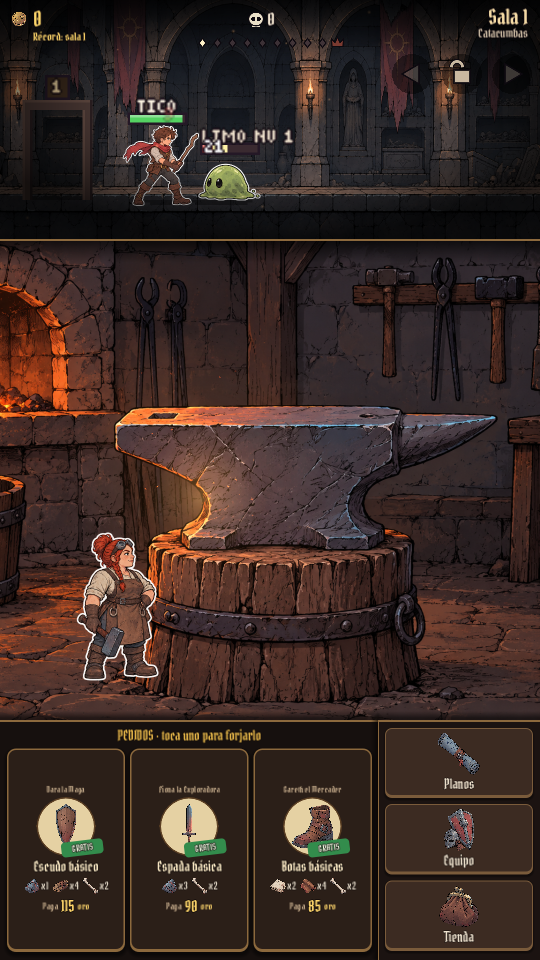
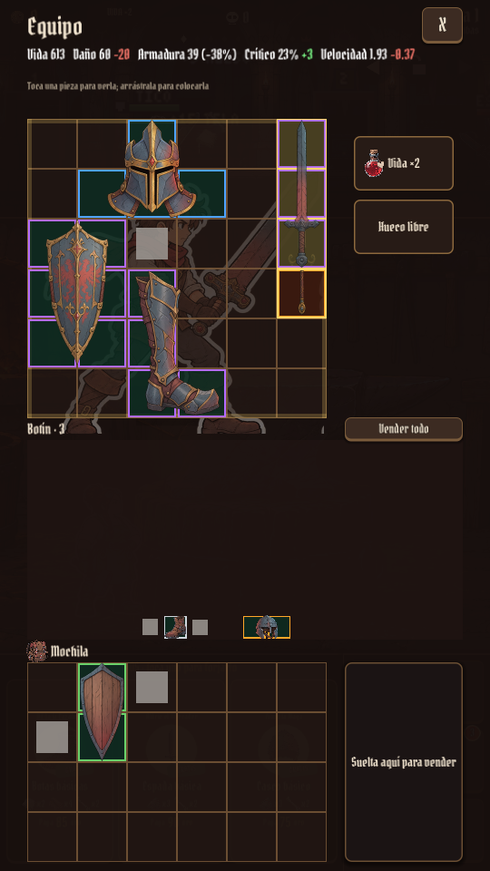
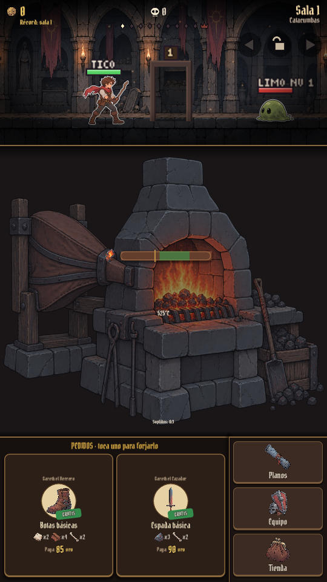
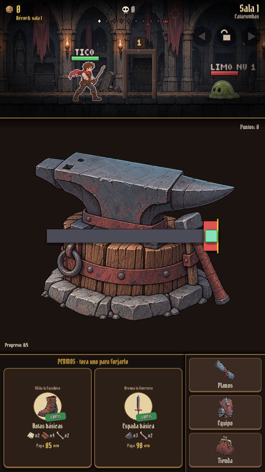
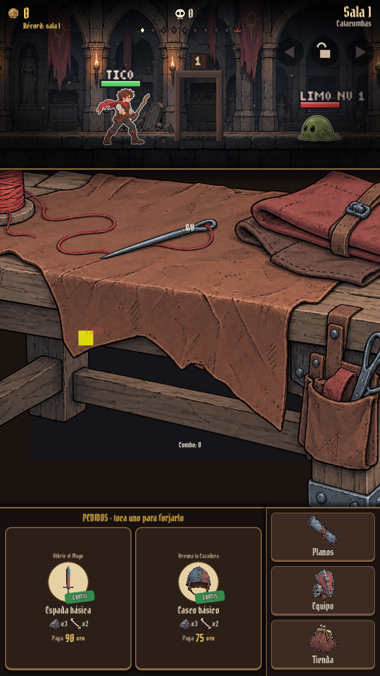
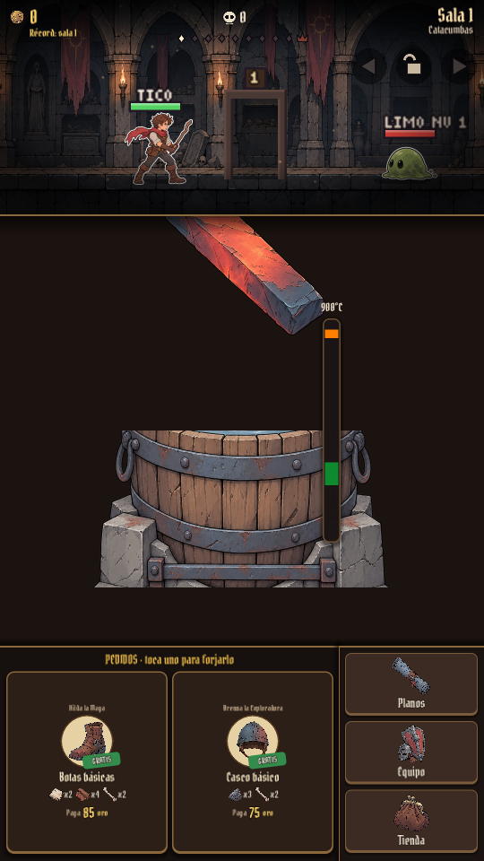

# Producción de arte de PetJam — 2 de octubre de 2026

La presentación posterior y los cambios de combate, inventario y tienda están documentados en [ajustes VS e inventario](2026-10-02-ajustes-vs-inventario.md).

El inventario completo tiene **78 recursos guardados y revisados**: 77 imágenes generadas para este lote y el fondo del taller reutilizado del piloto. Se ha aplicado el acabado de las armas antiguas al juego, con personajes de pocas poses en estilo sticker.

| Bloque | Resultado |
|---|---|
| Personajes | 15 hojas, 60 poses: Tico en cuatro niveles de equipo, cinco enemigos, cinco jefes y Brasa |
| Equipo | 22 piezas: 3 espadas, 3 escudos, 3 cascos, 3 botas y 10 armas futuras |
| Armas futuras | Aro, ballesta, cruz, espada con vaina, guadaña, guantelete, lanza, martillo, maza y pico |
| Objetos | 14 materiales y 3 pociones |
| Escenarios | Cinco biomas y taller ilustrado |
| Fabricación | Cuatro estaciones y cuatro herramientas |
| Interfaz y pantallas | Ocho iconos y dos ilustraciones de pantalla |

**67 recursos vinculados al juego y 11 preparados para uso futuro u opcional.** Las diez armas futuras conservan las formas de los JSON de inventario y tienen texturas listas para la rejilla. Sus objetos, estadísticas y recetas siguen pendientes de diseño. La pantalla de derrota está producida; el juego conserva su reaparición automática y utiliza la pose de derrota del personaje.

Cada personaje tiene cuatro estados discretos: reposo, ataque, daño y derrota. Brasa tiene reposo, martillo, costura y celebración; sus estados están conectados a fabricación, aunque el taller se oculta durante el minijuego. No se han creado ciclos completos de animación.

La integración incluye personajes, fondos de combate a todo el ancho, equipamiento de inventario y planos, materiales, pociones, botones, pantalla de inicio, taller y los cuatro minijuegos. Se han ajustado el tamaño de los iconos, la resolución del combate y las capas de las estaciones para mostrar las ilustraciones. Las formas de inventario y la lógica física del combate se mantienen.

Los originales y prompts están en `art/stickers/`. El atlas de personajes utiliza cuatro poses de 320 píxeles; las texturas de equipo usan 110 píxeles por celda. El arte antiguo se conserva. Los textos, marcos procedurales y efectos existentes siguen en uso.

## Comprobaciones

- Pruebas de combate y presentación en Godot: **161 comprobaciones, 0 fallos**.
- Prueba de poses: prioridad de daño y derrota, atlas de cuatro estados y respaldo ante un recurso ausente, superada.
- Inventario: los 78 originales existen; las 22 texturas de rejilla tienen las dimensiones de sus formas y transparencia válida.
- Capturas reales de inicio, juego, inventario, jefe, derrota y los cuatro minijuegos. Galería de todas las categorías sobre fondo de damero.
- Las capturas y pruebas del juego usan `--art-preview` para evitar alterar la partida guardada. No se ha realizado una exportación móvil en esta revisión.

## Capturas

Catálogos: [equipo](catalogo-equipo.png), [resto del equipo](catalogo-equipo-1.png), [personajes 1](catalogo-characters.png), [personajes 2](catalogo-characters-1.png), [personajes 3](catalogo-characters-2.png), [materiales](catalogo-materials.png), [pociones](catalogo-potions.png), [fondos](catalogo-backgrounds.png), [estaciones](catalogo-stations.png), [herramientas](catalogo-tools.png), [interfaz](catalogo-ui.png) y [pantallas](catalogo-screens.png).

Detalle individual: [inventario de producción](inventario-produccion.md). Guía de archivos y herramientas: [README del arte](../../art/stickers/README.md).
